# Gold Extended – Brushstroke FX for Blender

High-level painterly effects built on **Project Gold**'s
[Brushstroke Tools](https://studio.blender.org/tools/addons/brushstroke_tools)
add-on by the Blender Studio: rain, snow, sand, dust, dirt, clouds, grass,
foliage, hair, fire and water – every one painted with Project Gold brush
styles, animated procedurally, and driven by a curated set of controls.

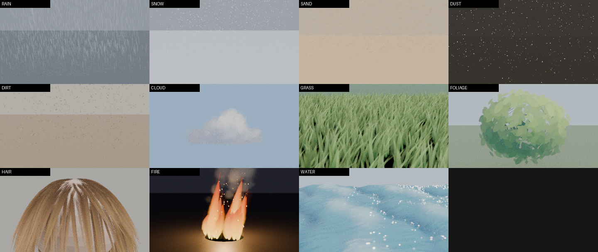

| Rain | Snow | Sand | Dust |
|---|---|---|---|
| 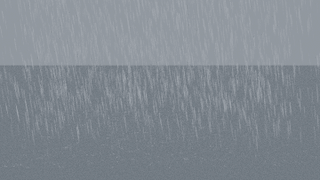 |  | 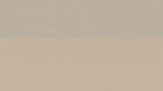 | 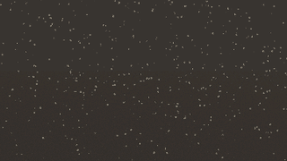 |
| **Dirt** | **Cloud** | **Grass** | **Foliage** |
| 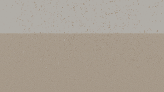 |  | 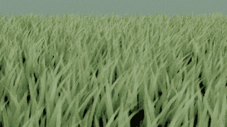 | 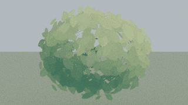 |
| **Hair** | **Fire** | **Water** | |
| 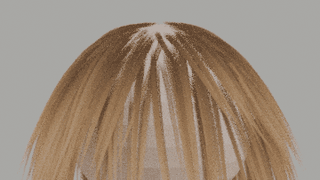 | 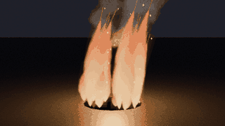 | 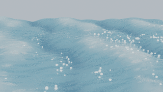 | |

*All previews: Cycles, built-in brush styles, default presets, rendered by
`tests/render_previews.py`. Every GIF is a seamless 24-frame loop made with the
effect's own **Loop Frames** control.*

## Features

* **7 effect engines, 11 one-click tools** – Particles (Rain, Snow, Sand,
  Dust, Dirt), Cloud, Grass, Foliage, Hair, Fire, Water; **38 presets**.
* **Brush textures from Project Gold.** Effects emit the same
  `brush_stroke.*` attributes as Brushstroke Tools, so any of its brush
  styles (e.g. the scanned oil-paint brushes) can paint them. Seven
  procedural styles are built in (Soft Dab, Bristle Dab, Streak, Flame
  Tongue, Puff, Leaf, Scumble), so the extension also works on its own.
* **Hyper-parameters mapped to a real interface** – controls in physical
  units (m, m/s, Hz, s, angles), grouped *Source → Shape → Motion → Stroke →
  Color → Animation*, with tooltips, an **Advanced** filter, built-in and
  **user presets**. Full reference: [docs/PARAMETERS.md](docs/PARAMETERS.md).
* **Animation built in and testable** – stateless and deterministic (scrub
  anywhere, render on any machine). **Loop Frames** makes any effect loop
  seamlessly; *Animation Test → Check Loop Seam* verifies it numerically.
* **Visual capabilities** – per-stroke *Look*: vibrance, saturation, hue,
  contrast, posterize, colour jitter, **chromatic fringe**, **iridescence**,
  **sheen**, **sheer**, translucency, emission, edge darkening, dry brush;
  plus a compositor **Scene Grade** (bloom, lens chromatic aberration,
  vibrance, vignette). 10 look presets (Oil Impasto, Watercolor, Gouache
  Flat, Vibrant Pop, Pastel, Prismatic, Silk Sheen, Ink Wash, Neon Glow…).

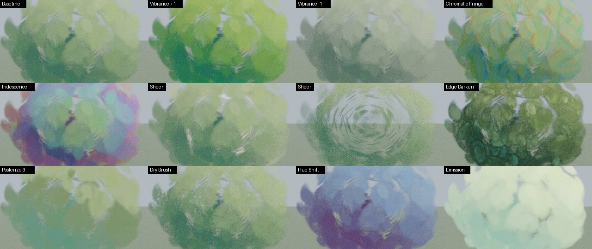

## Install

Requires **Blender 4.5 LTS or newer** (tested on 4.5.15 LTS and 5.2.3 LTS).

1. Build the extension zip (or download it from a release):
   ```
   blender --command extension build --source-dir gold_extended --output-dir dist
   # or, without Blender:  python scripts/build_extension.py
   ```
2. Blender → *Edit → Preferences → Get Extensions → ▾ → Install from Disk…* →
   `dist/gold_extended-1.0.0.zip`.
3. *Optional:* install **Brushstroke Tools**
   ([zip in `base/`](base/add-on-brushstroke-tools-v1.2.3.zip)) – its brush
   library is detected automatically and its styles appear in the brush
   picker. Extra libraries can be added in the preferences.

## Quick start

1. Open the sidebar in the 3D Viewport (**N**) → **Gold FX** tab
   (or *Add → Gold FX*).
2. **Create** – click an effect. Particles, Cloud and Foliage appear at the 3D
   cursor (scale/edit the object to change the domain/shape). Grass, Hair,
   Fire and Water grow on the **selected mesh** – or on a new default surface.
3. **Effect** – pick a preset, then tune the grouped controls. Toggle
   **Advanced** for fine tuning; **+** saves a user preset; ⟳ re-seeds.
4. **Look** – per material: choose a brush style, a look preset, then adjust
   Paint / Color / Chromatic / Light / Opacity.
5. **Animation Test** – set *Loop Frames*, *Fit to Loop*, *Play*, and
   *Check Loop Seam*.
6. **Scene Grade** – enable for bloom, chromatic aberration, vibrance and
   vignette on the final image.

Rendering with Cycles: creating an effect raises *transparent bounces* to 256
(same as Brushstroke Tools' Render Setup) – overlapping strokes otherwise
render black.

## Repository

```
base/            upstream Brushstroke Tools v1.2.3 (unmodified)
gold_extended/   the extension: core/ framework, effects/ recipes, ui, operators
tests/           headless test-suite and preview/showcase renderers
scripts/         extension build, parameter-doc generator
docs/            RESEARCH.md, ARCHITECTURE.md, PARAMETERS.md, media/
```

* [docs/RESEARCH.md](docs/RESEARCH.md) – analysis of the base add-on, the
  brush attribute contract, effect models and equations, hyper-parameter
  mapping, visual-capability exploration, validation results.
* [docs/ARCHITECTURE.md](docs/ARCHITECTURE.md) – layers, naming, version
  compatibility, how to add a new effect in ~40 lines.
* [docs/PARAMETERS.md](docs/PARAMETERS.md) – every control, generated from
  the code.

## Testing

```
pip install bpy==5.2.3   # or 4.5.x on Python 3.11
python tests/test_gold_extended.py            # 18 tests
python tests/test_gold_extended.py --render   # + Cycles render smoke test
python tests/render_previews.py --gif         # regenerate docs/media
python tests/render_showcase.py               # look / feature / sweep sheets
```

The suite checks the brush contract for every effect, motion and
determinism, seamless loops for **every preset**, masks, material
assignment, all operators, the Brushstroke Tools library bridge (with the
real oil-paint styles from `base/`), and validates every UI property path.

## Known limitations

* Strokes face the **scene camera**, also in the viewport.
* Motion is stateless: no accumulation or collisions (snow does not pile up).
* Looping quantises periods/frequencies to fit the loop, which can change
  speeds noticeably for very short loops.
* Look tuning was done in Cycles; EEVEE could not be tested on the headless
  build machine.

## Credits & license

GPL-3.0-or-later. Built on Brushstroke Tools © Blender Studio Tools Authors
(Project Gold); `core/compat.py` is adapted from its `geomod.py`.
